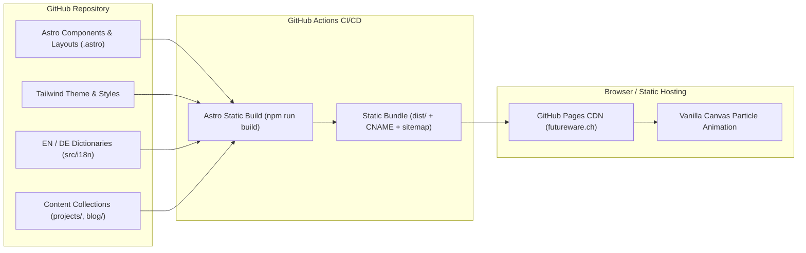

# ADR-0001: Static Site Architecture with Astro and Tailwind CSS on GitHub Pages

## Context and Problem Statement

FutureWare GmbH (`futureware.ch`) is replacing its existing Squarespace website with a fast, self-managed bilingual (EN/DE) company website hosted on GitHub Pages. Which frontend framework, styling toolchain, and content architecture should power the initial landing and legal pages while enabling effortless future expansion to "Projects / Use-Cases" and "Blog" sections without introducing server-side runtime dependencies?

## Decision Drivers

* **GitHub Pages compatibility**: Must build to pure static HTML, CSS, and minimal client-side JS deployable via GitHub Actions with custom domain (`futureware.dev`) support.
* **Design and animation fidelity**: Must faithfully reproduce the dark visual identity (`#030712`), sky-to-indigo gradients, card glow interactions, and interactive `<canvas>` neural-network particle animation from the approved `futureware_website.html` prototype without relying on the non-production Tailwind Play CDN.
* **Content extensibility**: Future "Projects / Use-Cases" and "Blog" pages must be authorable in Markdown/MDX with type-safe frontmatter validation, automatic route generation, and sitemap/RSS support.
* **Bilingual SEO and performance**: Must generate clean static HTML per locale with minimal JavaScript payload (zero UI framework runtime overhead where static markup suffices).
* **Low maintenance**: Simple build pipeline, minimal dependency churn, and straightforward local authoring.

## Considered Options

* **Option 1**: Astro 5 + Tailwind CSS + Astro Content Collections (Markdown/MDX)
* **Option 2**: Next.js (`output: 'export'`) + Tailwind CSS + MDX
* **Option 3**: Hugo + Tailwind CSS

## Decision Outcome

Chosen option: **"Option 1: Astro 5 + Tailwind CSS + Astro Content Collections (Markdown/MDX)"**, because Astro is purpose-built for content-driven static websites, ships zero JavaScript by default (allowing our vanilla `<canvas>` neural-network animation and progressive contact form script to run without React hydration overhead), provides built-in EN/DE i18n routing, and offers Zod-validated Content Collections tailored for future Blog and Projects/Use-Cases expansion on GitHub Pages.

### Consequences

* Good, because production CSS is compiled and purged at build time via Tailwind CSS, eliminating the runtime Play CDN script used in `futureware_website.html`.
* Good, because Astro Content Collections (`src/content.config.ts`) allow future Blog posts and Use-Case studies to be added by dropping `.md`/`.mdx` files into content directories with compile-time schema validation.
* Good, because official GitHub Actions integration (`withastro/action` + `actions/deploy-pages`) makes deployment to GitHub Pages deterministic and zero-cost.
* Bad, because developers/authors must run a Node.js build step (locally or via GitHub Actions) rather than editing a single standalone `.html` file directly on the branch.

### Confirmation

Compliance is confirmed when `npm run build` produces a purely static `dist/` bundle containing compiled Tailwind CSS, localized HTML routes, `CNAME` (`futureware.dev`), and sitemap XML, with zero runtime framework hydration scripts and passing Lighthouse performance/accessibility checks.

## Pros and Cons of the Options

### Option 1: Astro 5 + Tailwind CSS + Astro Content Collections (Markdown/MDX)

Component-based static site generator that renders `.astro` and `.mdx` templates to pure HTML at build time, with native i18n routing and Zod-backed content schemas.

* Good, because zero client-side JS framework runtime is shipped by default, maximizing Core Web Vitals (LCP/INP) on mobile and desktop.
* Good, because HTML-first `.astro` component syntax allows direct migration of markup, Tailwind theme tokens, and `<canvas>` scripts from `futureware_website.html`.
* Good, because Content Collections natively enforce frontmatter schemas for bilingual Blog and Use-Cases entries, and UI islands (React/Preact/Svelte) remain available later if interactive calculators or demos are ever needed.
* Neutral, because `.astro` single-file component syntax is Astro-specific (though closely aligned with standard HTML + TypeScript).
* Bad, because server-side Astro features (SSR middleware, server actions) are unavailable when targeting static GitHub Pages (`output: 'static'`).

### Option 2: Next.js (`output: 'export'`) + Tailwind CSS + MDX

React meta-framework configured for static HTML export (`output: 'export'`).

* Good, because React ecosystem libraries and TypeScript tooling are ubiquitous.
* Neutral, because Tailwind CSS integration is equally mature as in Astro.
* Bad, because static export ships ~80–100+ KB of React client runtime even for purely static marketing and legal pages.
* Bad, because Next.js App Router disables built-in `i18n` config and `next/image` optimization under `output: 'export'`, requiring manual `[lang]` dynamic segments and custom MDX collection plumbing for Blog/Use-Cases.

### Option 3: Hugo + Tailwind CSS

Go-based static site generator using Go `html/template` layouts and Markdown content bundles.

* Good, because single-binary builds are extremely fast and Hugo has mature built-in multilingual content bundles.
* Bad, because Go `html/template` syntax is cumbersome for componentizing rich Tailwind UI cards, SVG icons, and reusable interactive sections compared to `.astro` components.
* Bad, because Tailwind CSS still requires a Node.js/PostCSS or standalone Tailwind CLI pipeline alongside Hugo, negating the single-binary simplicity without offering MDX component embedding in future case studies.

## Architecture Diagram

## More Information

* Prototype reference: `futureware_website.html` in repository root.
* Enables: `ADR-0002` (Bilingual EN/DE Subpath Routing) and `ADR-0003` (Serverless Contact Form & Appointment Booking).
* Governs: `SPEC-0001` (`company-website`) and `SPEC-0002` (`content-extensibility`).
