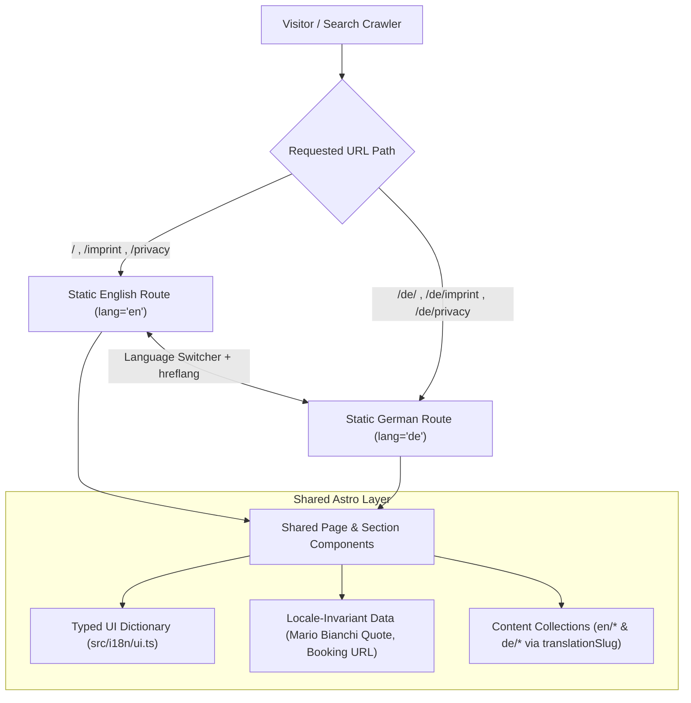

# ADR-0002: Bilingual (EN/DE) Subpath Routing and Translation Strategy

## Context and Problem Statement

FutureWare serves Swiss and international clients and requires full English (`en`) and German (`de`) language support across the landing page, legal pages (Imprint / Privacy Policy), and future Blog and Projects/Use-Cases pages. On static GitHub Pages (which lacks server-side `Accept-Language` content negotiation), how should bilingual URLs, UI translations, and localized content be structured for optimal UX, shareability, and SEO?

## Decision Drivers

* **Search engine indexing (SEO)**: Search engines must index distinct English and German URLs with accurate `<html lang="...">`, `<title>`, `<meta name="description">`, canonical tags, and `rel="alternate" hreflang` links.
* **GitHub Pages static hosting**: Root `/` must serve content immediately without relying on server-side HTTP 302 redirects or slow client-side meta-refresh hops.
* **Scalability to multi-page content**: Language switching must work consistently across `/`, `/imprint`, `/privacy`, and future `/projects/*` and `/blog/*` routes.
* **Authenticity of social proof**: Customer testimonials authored in a specific language (specifically Mario Bianchi's German review) must remain authentic and untranslated across both locales while keeping surrounding section headings localized.

## Considered Options

* **Option 1**: Astro Static Subpath Routing with Unprefixed Default Locale (`/` for `en`, `/de/` for `de`) + Typed Dictionaries & Per-Locale Content Collections
* **Option 2**: Prefixed Subpaths for All Locales (`/en/` and `/de/`) with Root `/` Client Redirect
* **Option 3**: Single-URL Client-Side CSS/DOM Language Toggle (`body[data-lang]`)

## Decision Outcome

Chosen option: **"Option 1: Astro Static Subpath Routing with Unprefixed Default Locale (`/` for `en`, `/de/` for `de`) + Typed Dictionaries & Per-Locale Content Collections"**, because it serves English directly at `https://futureware.ch/` with zero redirect latency on GitHub Pages, provides dedicated indexable `/de/...` URLs for German SEO, and scales cleanly to localized Markdown collections for Blog and Use-Cases.

### Consequences

* Good, because `https://futureware.ch/` renders full English HTML immediately (no redirect penalty) while `https://futureware.ch/de/` renders full German HTML, linked bidirectionally via `<link rel="alternate" hreflang="...">`.
* Good, because shared page templates (`LandingPage.astro`, legal layouts, future collection templates) consume a typed translation helper (`t(lang, key)`), eliminating duplicated `.lang-en`/`.lang-de` DOM nodes.
* Good, because authentic quotes (such as Mario Bianchi's German customer review) can be stored once as locale-invariant data while localizing surrounding headings and labels.
* Bad, because internal links must use a locale-aware path helper (`getRelativeLocaleUrl(lang, path)`) to avoid accidentally dropping a German visitor back onto an unprefixed English route.

### Confirmation

Compliance is confirmed when building the site produces separate static HTML files for `/` and `/de/` (plus `/imprint` & `/de/imprint`, `/privacy` & `/de/privacy`), each containing only its target locale's UI copy (except explicitly locale-invariant quotes), valid `<html lang="en|de">`, and reciprocal `hreflang` tags (`en`, `de`, `x-default`).

## Pros and Cons of the Options

### Option 1: Astro Static Subpath Routing with Unprefixed Default Locale (`/` for `en`, `/de/` for `de`)

Uses Astro's built-in `i18n` configuration (`defaultLocale: 'en'`, `locales: ['en', 'de']`, `routing: { prefixDefaultLocale: false }`), paired with `src/i18n/ui.ts` dictionaries for UI chrome and locale-scoped Content Collection entries (`en/...`, `de/...`) linked via a `translationSlug` frontmatter field.

* Good, because root domain `https://futureware.ch/` is directly crawlable and fast (zero client-side redirect hop).
* Good, because each page ships roughly half the DOM nodes compared to embedding both languages in one HTML document.
* Good, because deep links to German pages (`https://futureware.ch/de/#services`, `https://futureware.ch/de/projects/...`) are directly shareable.
* Neutral, because English URLs have no `/en/` prefix while German URLs have `/de/`.
* Bad, because templates must exist under both `src/pages/` and `src/pages/de/` (mitigated by thin route wrappers rendering shared page components).

### Option 2: Prefixed Subpaths for All Locales (`/en/` and `/de/`) with Root `/` Client Redirect

Configures `prefixDefaultLocale: true` so every page lives under `/en/...` or `/de/...`, with `index.html` at `/` executing a `<meta http-equiv="refresh">` or JS `location.replace()` redirect.

* Good, because URL structure is completely symmetrical between `/en/` and `/de/`.
* Bad, because GitHub Pages cannot issue an edge HTTP 301/302 redirect at `/`, forcing every root visitor and crawler through a client-side HTML redirect page that hurts Largest Contentful Paint (LCP) and root canonical authority.

### Option 3: Single-URL Client-Side CSS/DOM Language Toggle (`body[data-lang]`)

Retains the prototype mechanism from `futureware_website.html` where both `.lang-en` and `.lang-de` spans coexist in every HTML page and `localStorage` toggles CSS `display: none`.

* Good, because language toggling happens in-place without navigating to another URL.
* Bad, because search engines see concatenated English and German text in the same document while `<title>`, `<meta name="description">`, and `<html lang>` remain fixed to one language.
* Bad, because scaling to long-form Blog articles and Use-Case studies doubles HTML payload size and makes Markdown authoring unwieldy.

## Architecture Diagram

## More Information

* Extends: `ADR-0001` (Static Site Architecture with Astro and Tailwind CSS on GitHub Pages).
* Clarification decision recorded: Mario Bianchi's testimonial (`"Katarina ist ein Profi von A-Z..."`) is intentionally rendered untranslated in German on both EN and DE routes.
* Governs: `SPEC-0001` (`company-website`) and `SPEC-0002` (`content-extensibility`).
