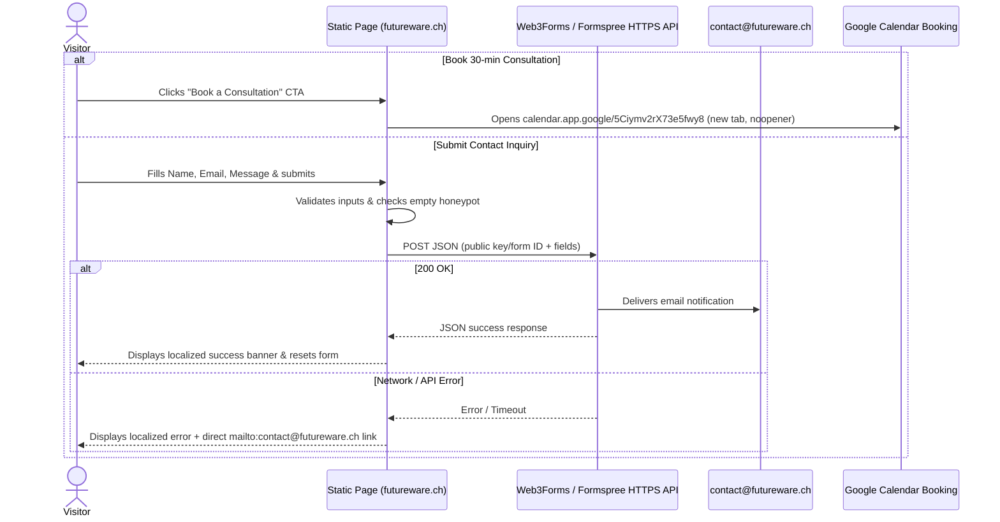

# ADR-0003: Serverless Contact Form Delivery and External Appointment Booking

## Context and Problem Statement

The FutureWare website requires both an interactive contact form delivering inquiries to `contact@futureware.ch` and a seamless way for prospective clients to book a 30-minute consultation, all while running on static GitHub Pages with no backend server. How should form submissions and appointment scheduling be handled reliably, securely, and with minimal operational overhead?

## Decision Drivers

* **Static hosting constraint**: GitHub Pages serves static files only and cannot execute server-side form handlers or store SMTP secrets.
* **Zero infrastructure maintenance**: Avoid operating a dedicated backend server or custom mail relay solely for website contact inquiries.
* **Spam resistance and UX**: Visitors should submit inquiries inline with clear localized (`en`/`de`) validation and status feedback, protected against basic bot spam without intrusive CAPTCHAs if avoidable.
* **Frictionless appointment booking**: Existing Google Calendar appointment scheduling (`https://calendar.app.google/5Ciymv2rX73e5fwy8`) is already active on `futureware.ch` and trusted by clients.
* **Swiss FADP / GDPR transparency**: Third-party processors handling visitor contact data must be minimized and clearly disclosed in the Privacy Policy.

## Considered Options

* **Option 1**: Serverless Form Endpoint Service (Web3Forms / Formspree) via `fetch()` + Direct Google Calendar Appointment Links
* **Option 2**: Custom Cloud Function / Automation Webhook (Cloudflare Worker or self-hosted n8n endpoint) + Embedded Calendar Iframe
* **Option 3**: Client-Side `mailto:` Link Fallback + Direct Google Calendar Links

## Decision Outcome

Chosen option: **"Option 1: Serverless Form Endpoint Service (Web3Forms / Formspree) via `fetch()` + Direct Google Calendar Appointment Links"**, because a managed static-form endpoint (defaulting to Web3Forms with configurable endpoint/key compatibility for Formspree) delivers messages straight to `contact@futureware.ch` using a public access key safe for static HTML, while linking CTAs directly to `https://calendar.app.google/5Ciymv2rX73e5fwy8` avoids third-party cookies/iframes on page load.

### Consequences

* Good, because visitors get a real, inline asynchronous contact form with localized success/error states and honeypot bot filtering—replacing the mock `setTimeout` handler in `futureware_website.html`—with zero servers to maintain.
* Good, because opening Google Calendar booking via external links (`target="_blank" rel="noopener noreferrer"`) keeps the landing page free of third-party Google tracking scripts or heavy iframes, simplifying Swiss FADP / GDPR compliance (no cookie banner needed for static visits).
* Good, because abstracting the form action URL and public access key into central site configuration allows switching between Web3Forms, Formspree, or a future FutureWare automation webhook without rewriting UI components.
* Bad, because form delivery depends on an external SaaS form gateway (mitigated by displaying `contact@futureware.ch` directly alongside/on error as a fallback).

### Confirmation

Compliance is confirmed when submitting the contact form sends a structured JSON/FormData `POST` request to the configured Web3Forms/Formspree endpoint with honeypot protection, announces localized loading/success/error states via an accessible `aria-live` region, and all consultation CTAs navigate to `https://calendar.app.google/5Ciymv2rX73e5fwy8`.

## Pros and Cons of the Options

### Option 1: Serverless Form Endpoint Service (Web3Forms / Formspree) via `fetch()` + Direct Google Calendar Links

Submits form fields (`name`, `email`, `message`, plus hidden honeypot field and public access key / form ID) over HTTPS `POST` to Web3Forms (`https://api.web3forms.com/submit`) or Formspree (`https://formspree.io/f/{id}`), forwarding emails to `contact@futureware.ch`. Consultation buttons link directly to Google Calendar's hosted booking page.

* Good, because public access keys/form IDs are designed to be embedded in static client-side code without exposing SMTP credentials.
* Good, because built-in honeypot + provider rate limiting blocks automated spam while keeping the UI clean.
* Good, because no third-party iframes or cookies load on `futureware.ch` until a user clicks to book an appointment.
* Neutral, because the site owner must generate a free public access key / form ID once and commit it (or set it as a build variable).
* Bad, because free tiers impose monthly submission caps (typically 50–250 submissions/month, ample for B2B consulting inquiries).

### Option 2: Custom Cloud Function / Automation Webhook + Embedded Calendar Iframe

Deploys a custom Cloudflare Worker or self-hosted n8n webhook to relay SMTP/API emails, and embeds Google Calendar's scheduling page inside an `<iframe>` or modal on the site.

* Good, because full control over webhook payload routing and CRM integration is possible.
* Bad, because operating, monitoring, and securing a custom public webhook endpoint (CORS, rate limiting, spam filtering, uptime) adds unnecessary DevOps burden for initial launch.
* Bad, because embedding Google Calendar in an `<iframe>` loads third-party Google scripts/cookies on the site, triggering stricter GDPR/FADP consent requirements and hurting page load performance.

### Option 3: Client-Side `mailto:` Link Fallback + Direct Google Calendar Links

Replaces form submission with a `mailto:contact@futureware.ch?subject=...&body=...` navigation.

* Good, because zero external form processor is involved.
* Bad, because `mailto:` fails silently or opens unconfigured desktop mail clients on many user devices, resulting in high drop-off and poor UX compared to the interactive form in `futureware_website.html`.

## Architecture Diagram

## More Information

* Extends: `ADR-0001` (Static Site Architecture with Astro and Tailwind CSS on GitHub Pages).
* Booking URL extracted from live `futureware.ch`: `https://calendar.app.google/5Ciymv2rX73e5fwy8`.
* Primary company inbox confirmed: `contact@futureware.ch` (FutureWare GmbH, Gulerstrasse 26, 7320 Sargans, Switzerland).
* Governs: `SPEC-0001` (`company-website`).
