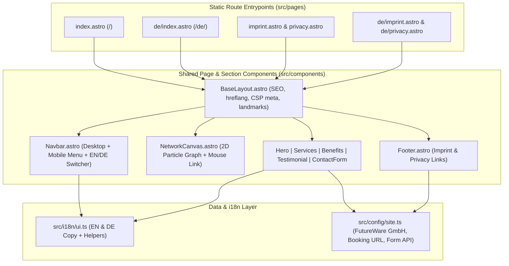

# Design: FutureWare Bilingual Company Website

## Context

FutureWare GmbH (`futureware.ch`) is pivoting its public website from a Squarespace-hosted Shopify development page to a custom, privacy-focused **Local AI & Automation Solutions** company site hosted on GitHub Pages. An HTML prototype (`futureware_website.html`) in the repository establishes the exact dark aesthetic, bilingual (EN/DE) service descriptions, and interactive neural-network `<canvas>` particle animation desired by the founder, while the live site (`https://futureware.ch/`) supplies the Google Calendar consultation link (`https://calendar.app.google/5Ciymv2rX73e5fwy8`), Mario Bianchi's customer testimonial (`https://rockylith.ch/`), and corporate legal details (`FutureWare GmbH`, `Gulerstrasse 26, 7320 Sargans, Switzerland`, `contact@futureware.ch`).

This design realizes `SPEC-0001` under the architectural governance of `ADR-0001` (Astro 5 + Tailwind CSS), `ADR-0002` (EN/DE static subpath routing), and `ADR-0003` (serverless contact form + external Google Calendar booking).

## Goals / Non-Goals

### Goals
- Deliver a production-ready, zero-framework-JS static website matching the visual look, feel, and `<canvas>` animation of `futureware_website.html`.
- Provide SEO-clean English (`/`) and German (`/de/`) routes with shared components and typed translation dictionaries.
- Wire consultation CTAs to `https://calendar.app.google/5Ciymv2rX73e5fwy8` and replace the prototype's mock form handler with real Web3Forms/Formspree submission to `contact@futureware.ch`.
- Integrate Mario Bianchi's original German testimonial on both EN and DE routes.
- Include complete EN/DE Imprint and FADP/GDPR-compliant Privacy Policy pages (self-hosting fonts so zero third-party requests occur on page load).
- Automate GitHub Pages deployment via GitHub Actions with `futureware.ch` custom domain configuration.

### Non-Goals
- Building a custom backend API, database, or self-hosted mail server.
- Embedding third-party calendar iframes or analytics/cookie-consent banners on initial launch.
- Translating Mario Bianchi's German quote into English (explicitly kept in original German per stakeholder decision).

## Decisions

### Componentized Shared Page Templates over Duplicated Locale Pages

**Choice**: Author locale-agnostic page views (`src/components/pages/HomePage.astro`, `ImprintPage.astro`, `PrivacyPage.astro`) that accept `lang: 'en' | 'de'`, mounted by thin 5-line route entrypoints in `src/pages/*.astro` and `src/pages/de/*.astro`.
**Rationale**: Keeps layout, Tailwind classes, accessibility attributes, and structural updates in a single place while producing 100% static localized HTML files at `/` and `/de/`.
**Alternatives considered**:
- Duplicating full HTML markup inside `src/pages/` and `src/pages/de/`: Error-prone; visual tweaks quickly drift between English and German pages.
- Dynamic `[...locale]` single catch-all route: Adds routing indirection for root `/` vs `/de/` when `prefixDefaultLocale: false` is used.

### Self-Hosted `Inter` Font Instead of Google Fonts CDN

**Choice**: Bundle `Inter` locally (via `@fontsource-variable/inter` or local WOFF2 font files) rather than linking `fonts.googleapis.com` as in `futureware_website.html`.
**Rationale**: Eliminates cross-origin DNS/TLS latency, tightens Content Security Policy (`font-src 'self'`), and ensures strict Swiss FADP / EU GDPR compliance (European/Swiss courts treat unconsented Google Fonts CDN IP disclosure as a privacy violation—critical for a company whose #1 value pillar is *"Data Privacy First"*).
**Alternatives considered**:
- Keep `fonts.googleapis.com` `<link>`: Contradicts FutureWare's *"strictly local and private"* brand positioning and leaks visitor IPs to Google on load.

### Progressive Canvas Lifecycle Management

**Choice**: Encapsulate `initNetworkAnimation()` in a dedicated `<NetworkBackground />` Astro component script that checks `window.matchMedia('(prefers-reduced-motion: reduce)')`, pauses the `requestAnimationFrame` loop on `document.visibilitychange`, and debounces `resize` calculations.
**Rationale**: Preserves the exact particle physics, colors, and mouse-connection behavior from `futureware_website.html` while preventing laptop battery drain on background tabs and satisfying WCAG 2.1 AA motion accessibility.
**Alternatives considered**:
- CSS-only background gradients: Loses the signature interactive neural-network particle animation requested by the user.
- Heavy WebGL/Three.js particle library: Adds ~150+ KB of unnecessary JS for a 2D particle effect that already runs cleanly in ~85 lines of Canvas 2D code.

### Provider-Agnostic Form Configuration (`src/config/site.ts`)

**Choice**: Centralize `contactForm: { provider: 'web3forms' | 'formspree', endpoint: string, accessKey: string }`, `bookingUrl`, and `company` metadata in `src/config/site.ts` (overridable via `PUBLIC_WEB3FORMS_KEY` / `PUBLIC_FORMSPREE_ENDPOINT` env vars at build time).
**Rationale**: Allows immediate local testing and seamless key configuration in GitHub Repository Variables/Secrets without touching form markup or script logic.
**Alternatives considered**:
- Hardcoding endpoint URLs and keys inline inside `<form>`: Harder to audit, rotate, or switch between Web3Forms and Formspree.

## Architecture

## Risks / Trade-offs

- **Unconfigured form key on first deploy** → Mitigate by reading `PUBLIC_WEB3FORMS_KEY` (or `PUBLIC_FORMSPREE_ENDPOINT`) at build time and gracefully displaying a clear direct-email (`contact@futureware.ch`) + Google Calendar action if the key is empty or returns an API error.
- **GitHub Pages lacks custom HTTP security headers (`X-Frame-Options`)** → Mitigate with `<meta http-equiv="Content-Security-Policy">` and `<meta name="referrer">` for all directives supported in meta tags; no sensitive authenticated state exists to clickjack.
- **Canvas CPU usage on ultra-wide displays** → Mitigate by preserving the `Math.min(Math.floor(window.innerWidth / 12), 120)` particle cap from `futureware_website.html` and pausing when `document.hidden` is true.

## Migration Plan

1. Build and verify the static site on a GitHub Pages preview URL (`https://<org-or-user>.github.io/<repo>/`) before switching production DNS.
2. Add the Web3Forms public access key (configured for `contact@futureware.ch`) or Formspree endpoint in GitHub Actions repository variables (`PUBLIC_WEB3FORMS_KEY`).
3. Configure custom domain `futureware.dev` in GitHub Pages settings (GitHub Actions ignores `CNAME` files) and update DNS `A`/`AAAA` (`185.199.108.153`–`.111.153`) and `www` `CNAME` records away from Squarespace.
4. Enable **"Enforce HTTPS"** in GitHub Pages once Let's Encrypt certificate provisioning completes.
5. **Rollback**: Re-point DNS records to Squarespace if an urgent rollback is required during cutover.

## Open Questions

- Whether a Web3Forms access key or a Formspree endpoint ID will be supplied first at deployment time (both are supported out of the box via `src/config/site.ts` / build env vars).
