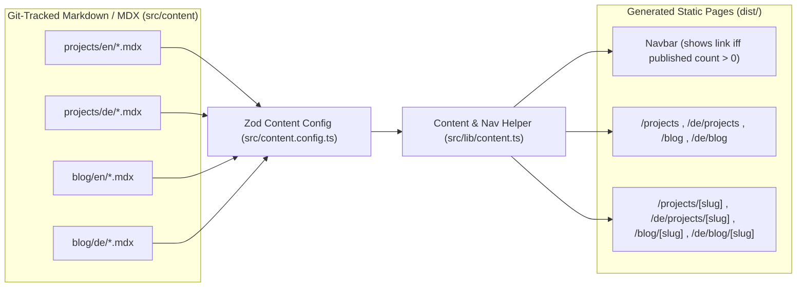

# Design: Extensible Content Collections for Projects and Blog

## Context

FutureWare plans to expand `futureware.ch` after the initial launch with **"Projects / Use-Cases"** (client case studies and reference architectures) and **"Blog"** (technical articles on local LLMs, RAG, and workflow automation) in both English and German. `SPEC-0002` ensures the Astro project scaffolded under `ADR-0001` and `ADR-0002` includes first-class content schemas, route templates, typography styling, and conditional navigation from day one—so publishing future content is a pure Markdown/MDX authoring task rather than a frontend refactor.

## Goals / Non-Goals

### Goals
- Pre-wire Astro 5 Content Collections (`projects` and `blog`) with strict Zod schemas in `src/content.config.ts`.
- Automatically hide empty sections from navigation at launch while immediately enabling them once published (`draft: false`) content is committed.
- Support optional 1-to-1 or asymmetric EN/DE translations via `translationSlug` without broken `404` language-switcher links.
- Provide cohesive dark-mode prose typography (`@tailwindcss/typography` or custom dark prose tokens matching `#030712` and `#38bdf8` accents) and end-of-article consultation CTAs.

### Non-Goals
- Integrating a headless CMS (Decap, Sanity, Contentful) — Git-backed Markdown/MDX files in `src/content/` provide zero-cost, version-controlled authoring suited to a technical founder.
- Full-text client-side search UI (can be added later via Pagefind once article volume warrants it).
- Comments or user-generated content.

## Decisions

### Locale Subdirectories Inside Content Collections (`src/content/{collection}/{lang}/`)

**Choice**: Organize entries under `src/content/projects/en/*.md(x)`, `src/content/projects/de/*.md(x)`, `src/content/blog/en/*.md(x)`, and `src/content/blog/de/*.md(x)` alongside an explicit `lang: 'en' | 'de'` frontmatter field and shared `translationSlug`.
**Rationale**: Keeps English and German articles cleanly separated on disk, allows identical URL slugs per language (e.g., `/projects/invoice-automation` and `/de/projects/rechnungsautomatisierung` linked via `translationSlug: "invoice-automation"`), and avoids filename suffixes like `.de.md`.
**Alternatives considered**:
- Single file containing both EN and DE Markdown bodies: Impossible to author cleanly for long-form articles and breaks standard Markdown tooling.
- Filename suffixes (`my-post.en.md`, `my-post.de.md`) in a flat folder: Gets cluttered quickly and forces identical slugs across languages even when localized German URL slugs are preferable for SEO.

### Build-Time Navigation Auto-Discovery

**Choice**: Create a lightweight helper `getNavigationItems(lang)` in `src/lib/content.ts` that queries `getCollection('projects', e => !e.data.draft && e.data.lang === lang)` and `getCollection('blog', ...)` at build time to include *"Projects / Projekte"* and *"Blog"* nav links automatically as soon as `count > 0`.
**Rationale**: Ships a clean, distraction-free initial website (even with sample `draft: true` starter templates in `src/content/` documenting how to add entries!) while guaranteeing zero code changes are needed to publish the first real case study or blog post.
**Alternatives considered**:
- Leaving empty "Coming Soon" links in the top navbar: Hurts credibility on a B2B consulting site.
- Commenting out routes and navbar JSX manually: Requires code edits instead of pure content commits when publishing later.

## Architecture

## Risks / Trade-offs

- **Asymmetric translations (an article published in EN before DE is ready)** → Mitigated by making `translationSlug` optional and verifying target existence at build time; the language switcher falls back to `/de/blog` (or `/de/projects`) rather than generating a dead link.
- **Unstyled Markdown elements (tables, code blocks, blockquotes) clashing with `#030712` dark theme** → Mitigated by configuring dark-theme prose styles (`prose-invert` with `brand-400` links and `gray-900` code blocks) in the shared article layout.

## Migration Plan

Greenfield capability scaffolded alongside `SPEC-0001`. Seed one `draft: true` example file in `src/content/projects/` and `src/content/blog/` so the author has an in-repo template ready to copy and flip to `draft: false` whenever the first case study or post is ready.

## Open Questions

- Whether RSS feeds (`/rss.xml`, `/de/rss.xml`) should be enabled immediately once the first `blog` post is published (trivial to add via `@astrojs/rss` when desired).
